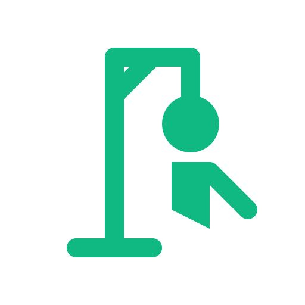
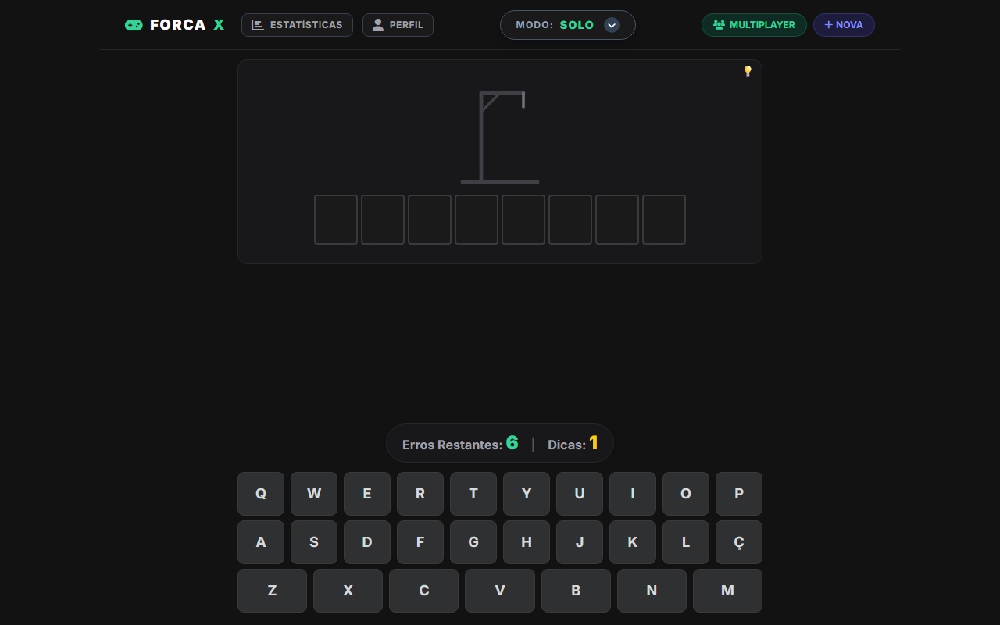
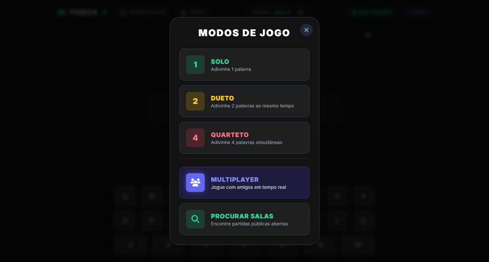
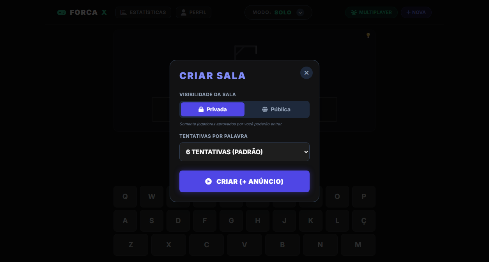

<div align="center">
  
  <h1>FORCAX</h1>
  <p>
    <strong>O clássico jogo da Forca, reinventado com desafios diários, múltiplos tabuleiros e modo Multiplayer em tempo real.</strong>
  </p>

  <p>
    <a href="https://forca.free.nf/" target="_blank">
      
    </a>
    <a href="https://ko-fi.com/rafaelnishimura" target="_blank">
      
    </a>
  </p>

  <p>
    
    
    
    
    
  </p>
</div>

---

## 🌐 Jogue Online

Acesse agora mesmo pelo navegador ou instale como aplicativo (PWA) no celular e desktop:

👉 **[https://forca.free.nf/](https://forca.free.nf/)**

---

## ✨ Funcionalidades

- **Modos Diários:**
  - **Solo:** Adivinhe 1 palavra por dia.
  - **Dueto:** Adivinhe 2 palavras simultaneamente.
  - **Quarteto:** O desafio máximo com 4 palavras ao mesmo tempo.
- **Multiplayer em Tempo Real:**
  - Crie salas **públicas** ou **privadas** (protegidas por código e aprovação de entrada pelo host).
  - Placar ao vivo (**Copa VIP**) acompanhando erros, palavras completadas e progresso de cada jogador.
  - Controle de sala para o host (expulsar jogadores, promover novo host, iniciar próxima partida).
- **Sistema de Dicas & Palavras Extras:**
  - Use dicas estratégicas durante a partida e desbloqueie palavras extras após concluir o desafio diário.
- **Estatísticas & Ranking:**
  - Acompanhe total de jogos, porcentagem de vitórias, sequência atual (*streak*), melhor sequência, distribuição de erros e comparativo **Regional vs Global**.
  - Compartilhamento de resultado com um clique.
- **Multilíngue:** Suporte integrado para **Português (`pt`)**, **Inglês (`en`)** e **Espanhol (`es`)**.
- **PWA (Progressive Web App):** Suporte offline básico, ícone dedicado e instalação direta via navegador (`manifest.json` + `sw.js`).
- **Painel Administrativo:** Gerenciamento de patrocinadores, configurações globais, provedores de anúncios (Adsterra / Google AdSense H5 Games), link de doação e renomeação dinâmica de slug para segurança.

---

## 📸 Screenshots

| Tela Principal (Solo / Tabuleiro) | Seleção de Modos | Multiplayer & Salas |
| :---: | :---: | :---: |
|  |  |  |

---

## 🛠️ Tecnologias Utilizadas

- **Frontend:** HTML5, Tailwind CSS, JavaScript (ES Modules), Font Awesome 6, Canvas Confetti
- **Backend:** PHP (PDO & MySQLi)
- **Banco de Dados:** MySQL / MariaDB
- **PWA:** Web App Manifest + Service Worker

---

## 🚀 Como Rodar Localmente

### Pré-requisitos
- PHP 8.0+ e MySQL/MariaDB (ex.: **XAMPP**, Laragon ou Docker)

### Passo a passo

1. **Clone o repositório:**
   ```bash
   git clone https://github.com/nyshimura/forcax.git
   cd forcax
   ```

2. **Importe o banco de dados:**
   - Crie um banco de dados chamado `forca` no MySQL/phpMyAdmin.
   - Importe o arquivo [`forca.sql`](forca.sql).

3. **Configure a conexão (opcional para produção):**
   - Em ambiente local (`localhost`), o arquivo [`api/db.php`](api/db.php) já utiliza por padrão `host=localhost`, `db=forca`, `user=root` e senha vazia.
   - Para produção, defina as variáveis de ambiente `DB_HOST`, `DB_NAME`, `DB_USER` e `DB_PASS` (ou ajuste diretamente em [`api/db.php`](api/db.php)).

4. **Acesse no navegador:**
   - Coloque a pasta em `htdocs/forca` (no XAMPP) e acesse `http://localhost/forca/`.

---

## 📁 Estrutura do Projeto

```text
forcax/
├── api/                     # Endpoints REST em PHP (jogo, salas, palavras, stats)
├── css/                     # Estilos customizados
├── js/                      # Lógica do jogo, UI, estado e multiplayer (ES Modules)
├── painel_secreto_forca/    # Painel administrativo (patrocinadores e configurações)
├── uploads/                 # Diretório para banners de patrocinadores
├── .htaccess                # Proteção de arquivos sensíveis e bloqueio de listagem
├── forca.sql                # Dump completo do banco de dados
├── index.php                # Aplicação principal
├── manifest.json            # Configuração PWA
└── sw.js                    # Service Worker
```

---

## ☕ Apoie o Projeto

Se você curtiu o **Forcax** e quer ajudar a manter o servidor online e novas atualizações chegando, considere pagar um café!

<a href="https://ko-fi.com/rafaelnishimura" target="_blank">
  
</a>

---

<div align="center">
  Feito com 💚 por <a href="https://github.com/nyshimura">Rafael Nishimura</a>
</div>
